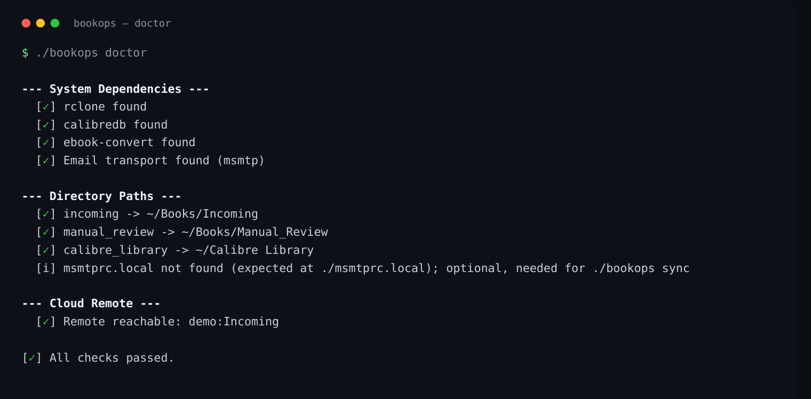

# BookOps

Unix-inspired digital library automation: **poll a cloud folder, catalogue books into
Calibre, and deliver them to a Kindle** — by email or over USB.

BookOps is deliberately small and scriptable. Each stage is a normal command-line tool
(`rclone`, `calibredb`, `ebook-convert`, `msmtp`), glued together by a shell/Python
pipeline that you can read, modify and run by hand.

## How it works

```
Google Drive
    │  watcher.sh / pipeline.sh  (rclone copy)
    ▼
~/Books/Incoming
    │  ingest.py  (calibredb add)
    ▼
Calibre Library  ── metadata.db
    │
    ├── sync.sh       calibredb search → export EPUB → msmtp → Kindle email
    │
    └── usb_sync.py   calibredb list → match → convert to AZW3 → copy → unmount
```

## Commands

| Command | Description |
|---|---|
| `./bookops doctor` | Check dependencies, paths, config and cloud remote |
| `./bookops watch` | Daemon: poll the cloud folder every 10 s and ingest new files |
| `./bookops run` | One-shot pipeline: pull from cloud, ingest, then USB-sync |
| `./bookops sync` | Email new Calibre books to the Kindle address |
| `./bookops usb-sync` | USB sync: detect Kindle, compare libraries, convert, copy, unmount |
| `./bookops refresh` | Refresh covers and force a full USB re-sync |
| `./bookops dedup` | Remove duplicate book files from a mounted Kindle |
| `./bookops version` | Print the version |

## Requirements

- **Linux** for the full experience (systemd user service, automatic Kindle mount
  detection). The core scripts should work on macOS with manual paths, but the service
  and `/media/<user>/Kindle` detection are Linux-oriented.
- Python **3.9+** (standard library only).
- [`rclone`](https://rclone.org/) — cloud sync.
- [Calibre](https://calibre-ebook.com/) — provides `calibredb` and `ebook-convert`.
- [`msmtp`](https://marlam.de/msmtp/) — SMTP client for Kindle email delivery.
- A Google Drive (or other rclone) remote, a Kindle Send-to-Kindle address, and an SMTP
  account. Gmail requires an **App Password**; your normal password will not work.

Install the dependencies on Debian/Ubuntu:

```bash
sudo apt install -y rclone calibre msmtp
```

## Setup

### 1. Clone and configure rclone

```bash
git clone https://github.com/georgian3768/bookops.git
cd bookops

rclone config
# Create a remote named "gdrive" and authenticate with Google Drive.
rclone mkdir gdrive:Incoming
```

You can use any rclone remote path in `gdrive_remote_path`; the name `gdrive` is only a
convention.

### 2. Create the BookOps config

```bash
cp config.example.json config.json
$EDITOR config.json
```

| Key | Meaning |
|---|---|
| `incoming` | Local folder where cloud files are downloaded (`~` is expanded) |
| `manual_review` | Folder for files that cannot be processed automatically |
| `calibre_library` | Path to the Calibre library directory (the one containing `metadata.db`) |
| `gdrive_remote_path` | rclone remote and folder, e.g. `gdrive:Incoming` |
| `kindle_email` | Your Send-to-Kindle address (`...@kindle.com`) |
| `convert_pdfs` | Convert PDFs to EPUB before adding them to Calibre |

`config.json` is gitignored. Keep your real paths and email address out of git.

### 3. Configure email delivery (optional)

Only needed for `./bookops sync`. For Gmail:

1. Enable 2-step verification on the Google account.
2. Create an **App Password** at <https://myaccount.google.com/apppasswords>.
3. Copy the example and fill it in:

```bash
cp msmtprc.example msmtprc.local
chmod 600 msmtprc.local
$EDITOR msmtprc.local
```

Test the SMTP login without sending mail:

```bash
msmtp --file=msmtprc.local --serverinfo
```

Then add your sender address to the Amazon **Approved Personal Document E-mail List**
(Manage Your Content and Devices → Preferences → Personal Document Settings). Amazon
rejects mail from unapproved senders.

### 4. Check the installation

```bash
./bookops doctor
```

The doctor checks binaries, directories, config keys and the rclone remote. Fix anything
marked with a red cross before running the pipeline.



*`./bookops doctor` reports each dependency, path and the cloud remote in one pass.*

### 5. Optional: run the watcher as a user service

```bash
mkdir -p ~/.local/bin
ln -sf "$PWD/bookops" ~/.local/bin/bookops

mkdir -p ~/.config/systemd/user
cp systemd/bookops-watcher.service ~/.config/systemd/user/
systemctl --user daemon-reload
systemctl --user enable --now bookops-watcher

journalctl --user -u bookops-watcher -f
```

The unit calls `%h/.local/bin/bookops watch`; the symlink keeps the checkout location
independent. If you prefer a different path, edit `ExecStart` in the unit.

## Usage

```bash
# One-shot: pull from the cloud, ingest, USB-sync
./bookops run

# Watch the cloud folder continuously
./bookops watch

# Email new Calibre books to the Kindle
./bookops sync

# Copy new books over USB
./bookops usb-sync

# Refresh covers and force a full USB re-sync
./bookops refresh
```

All runtime state is kept in ignored dot-files in the repository root:

- `.bookops_last_sync` — timestamp of the last successful email sync
- `.bookops_sent_ids` — Calibre IDs already emailed
- `.bookops_usb_sent_ids` — Calibre IDs already copied over USB

To seed the “already sent” list from an existing library:

```bash
calibredb search "" --library-path="$HOME/Calibre Library" \
  | tr ',' '\n' > .bookops_sent_ids
```

## Security notes

- `msmtprc.local` contains an SMTP **credential**. It is gitignored and should be
  `chmod 600`. Treat an App Password like a password: revoke it if it leaks.
- `config.json` contains your Kindle email and local paths. It is gitignored.
- rclone stores OAuth tokens in `~/.config/rclone/rclone.conf`, outside this repository.
- Never commit `msmtprc.local`, `config.json`, `msmtp.log` or the `.bookops_*` state files.
- Amazon's Send-to-Kindle service accepts attachments up to 50 MB; larger files are
  rejected by Amazon even if the SMTP server accepts them.

## File layout

```
bookops/
├── bookops                     CLI router (Bash)
├── config.example.json         Template configuration
├── msmtprc.example             Template SMTP configuration
├── systemd/
│   └── bookops-watcher.service User service for the watcher
├── scripts/
│   ├── doctor.py               Diagnostics
│   ├── ingest.py               Single-book ingestion and cataloguing
│   ├── sync.sh                 Email sync (calibredb → msmtp)
│   ├── pipeline.sh             One-shot cloud → ingest → USB pipeline
│   ├── watcher.sh              Cloud polling daemon
│   ├── refresh.sh              Covers + forced USB sync
│   ├── usb_sync.py             USB sync (mount → match → convert → copy)
│   └── dedup.py                Remove duplicate Kindle files
└── tests/
    ├── test_doctor.py
    ├── test_ingest.py
    └── test_usb_sync.py
```

## Testing

```bash
python3 -m unittest discover -s tests -v
```

The tests use temporary directories and mock external commands; they do not need Calibre,
a Kindle or a Google account. The CI workflow also runs `bash -n` over the shell scripts.

## Troubleshooting

| Symptom | Likely cause |
|---|---|
| `Calibre GUI is running` | Close the Calibre desktop app; it locks `metadata.db` |
| `Cannot reach remote path` | Wrong `gdrive_remote_path`, or rclone is not authenticated |
| `msmtprc.local not found` | Copy `msmtprc.example` and set up the App Password |
| Kindle never receives mail | Sender is not on Amazon's approved list, or the attachment is >50 MB |
| `calibredb: command not found` | Calibre is not installed or not on `PATH` |
| USB sync cannot find the Kindle | The device is not mounted; check `lsblk` and the `/media/<user>/Kindle` path |

Exit codes used by the scripts: `0` = OK, `1` = file/user error, `2` = configuration
error, `3` = missing system dependency.

## License

MIT — see [LICENSE](LICENSE).
